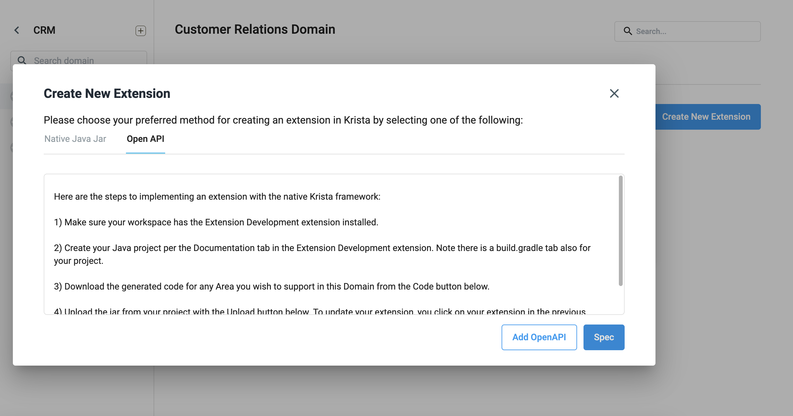
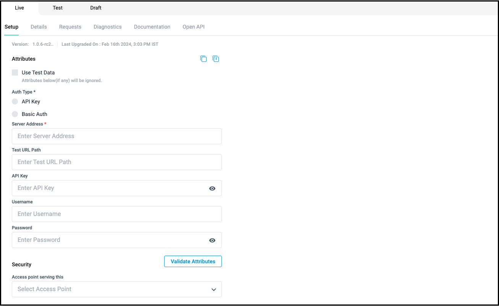
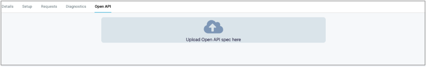
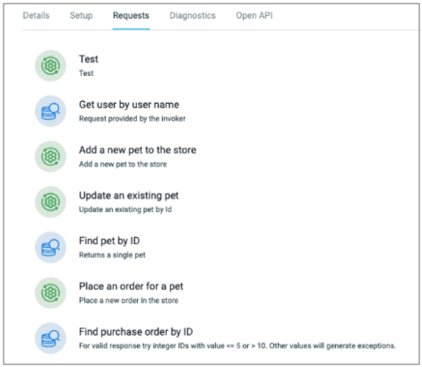
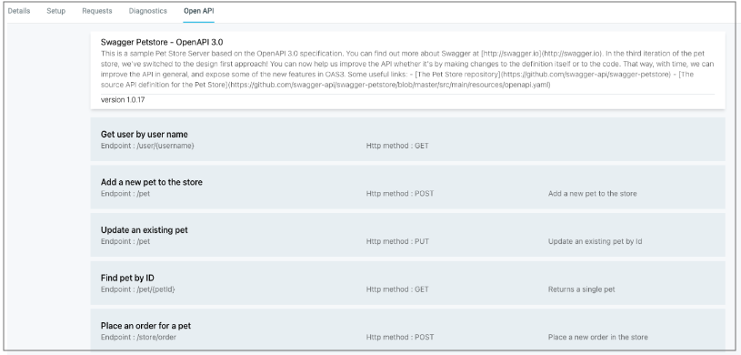
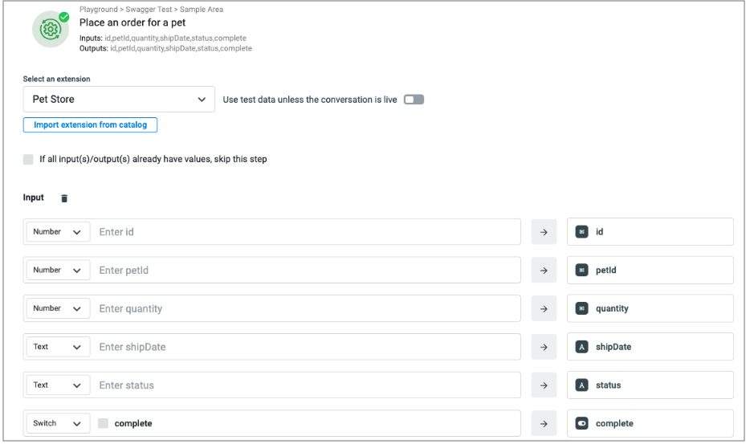
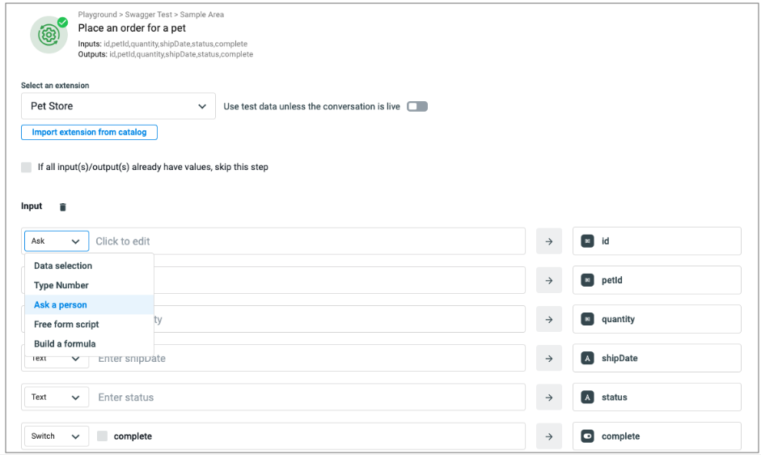
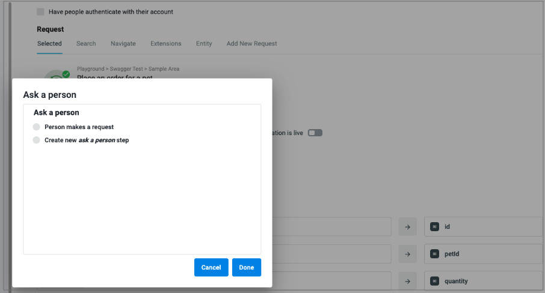
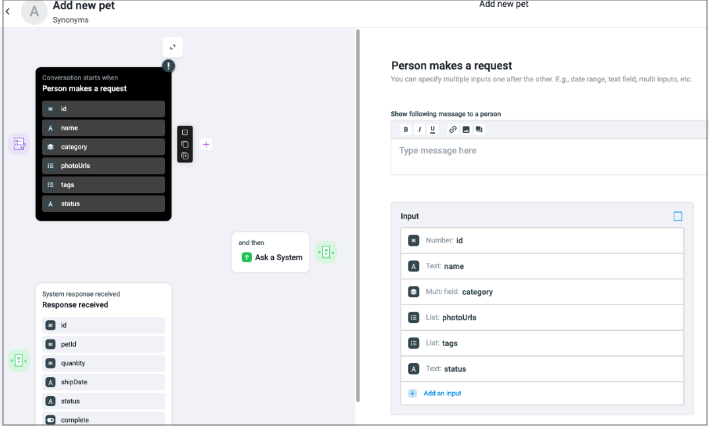

# Krista Access Existing REST Service Extension

## Overview

The Krista Access Existing REST Service extension enables seamless integration with external REST APIs within the Krista ecosystem. This powerful extension allows you to connect to pre-existing REST services, upload OpenAPI specifications, and dynamically generate catalog requests for use in your conversations.

Whether you need to integrate with third-party APIs, legacy systems, or custom REST services, this extension provides a flexible and efficient solution that leverages the full capabilities of the Krista platform.

## Key Features

✅ **Multiple Authentication Methods**: Support for API Key and Basic Authentication
✅ **Dynamic Catalog Requests**: Generate catalog requests from OpenAPI specifications
✅ **Token Management**: Store, retrieve, and manage authentication tokens within conversations
✅ **Entity Support**: Full support for entities and entity requests from OpenAPI specs
✅ **Flexible Configuration**: Easy setup with validation and testing capabilities
✅ **Conversation Scoped**: Secure token management scoped to individual conversations
✅ **OpenAPI 3.0 Compatible**: Full support for OpenAPI 3.0 specifications
✅ **Code Generation**: Generate client code for various programming languages

## Quick Start Guide

### 1. Prerequisites
- Valid server address for your REST service
- API credentials (API Key or Username/Password)
- OpenAPI specification file (optional, for dynamic requests)

### 2. Basic Setup
1. Configure authentication in the extension setup page
2. Test connectivity using the validation feature
3. Upload your OpenAPI specification (if available)
4. Start using the generated catalog requests in your conversations

### 3. First API Call
1. Create a conversation with an "Ask a System" step
2. Select your configured REST extension
3. Choose from available catalog requests
4. Map input parameters and execute

## Documentation Structure

### Getting Started
- [Extension Configuration](/pages/ExtensionConfiguration.md) - Complete setup and configuration guide
- [Authentication](/pages/Authentication.md) - Authentication methods and security best practices

### Token Management
- [Store Token](/pages/StoreToken.md) - Store authentication tokens for conversation use
- [Get Token](/pages/GetToken.md) - Retrieve stored authentication tokens
- [Delete Token](/pages/DeleteToken.md) - Remove stored authentication tokens

### Advanced Topics
- [Code Generation](#code-generation-for-a-domain-using-openapi) - Generate client code from OpenAPI specs
- [Entity Support](#entity-support) - Working with entities and entity requests
- [Usage Examples](#usage-examples) - Real-world implementation examples
- [Limitations](#limitations-and-caveats) - Current limitations and considerations

### Reference
- [Release Notes](/pages/ReleaseNotes.md) - Version history, changelog, and upgrade instructions

## Support & Resources

- **Extension Version**: 1.0.8
- **Developer**: Pulkit Jareda
- **Krista Service APIs Java**: 1.0.93-rc2
- **Global Catalog Version**: 1.0.44
- **OpenAPI Support**: 3.0+

## Code Generation for a Domain using OpenAPI

Generate client code for your REST service using OpenAPI specifications:

1. **Download OpenAPI Spec**: Navigate to your domain's extension tab and download the OpenAPI specification
   

2. **Install OpenAPI Generator**:
   ```bash
   # For macOS with Homebrew
   brew install openapi-generator
   ```

3. **Generate Client Code**:
   ```bash
   openapi-generator generate -i <spec-file> -g <language> -o <output-directory>
   # Example: openapi-generator generate -i petstore.json -g java -o output
   ```

4. **Configure Project**: Follow the README instructions in the generated output directory

## Entity Support

The extension provides comprehensive entity support through OpenAPI specifications:

- **Dynamic Generation**: Entities and entity requests are generated automatically from OpenAPI specs
- **UI Integration**: Generated entities appear in the extension's user interface
- **Conversation Usage**: Entities can be utilized directly within conversations
- **API Encoding**: Entity requests are encoded as API requests within the specification
- **Implementation Requirements**: Developers must properly implement the APIs for entities to function correctly

## Configuration Overview

The extension supports flexible configuration for various authentication methods and REST service connections. For detailed setup instructions, see the [Extension Configuration](/pages/ExtensionConfiguration.md) guide.

### Quick Configuration Steps

1. **Choose Authentication Method**: Select API Key or Basic Auth based on your service requirements
2. **Configure Server Connection**: Enter your REST service's base URL and optional test path
3. **Set Up Authentication**: Provide API key or username/password credentials
4. **Validate Connection**: Test connectivity using the built-in validation feature
5. **Upload OpenAPI Spec**: Upload your OpenAPI specification for dynamic catalog request generation
6. **Access Generated Requests**: Use the dynamically created catalog requests in your conversations



### OpenAPI Specification Upload

Upload your OpenAPI specification to automatically generate catalog requests and entities:



### Generated Catalog Requests

After uploading your specification, the extension creates dynamic catalog requests that appear in the Requests tab:



Each catalog request displays detailed information including HTTP method, parameters, and descriptions:



> **📝 Note**: Dynamic catalog requests are only visible within the extension and not in the general catalog.

## Usage Examples

### Creating Conversations with Dynamic Catalog Requests

Once your OpenAPI specification is uploaded and catalog requests are generated, you can integrate them into your conversations:

#### Step 1: Set Up Ask a System Step
Create an "Ask a System" step and select your configured REST extension from the Extensions tab.

#### Step 2: Select Catalog Request
Choose the specific API operation from the list of available catalog requests. The input fields defined in the OpenAPI specification will be displayed automatically.



#### Step 3: Configure Input Parameters
Map the required input parameters either by copying variables from previous steps or creating new "Ask a Person" steps to collect user input.



#### Step 4: Choose Variable Mapping
Select how you want to handle the input variables - either through user prompts or direct variable assignment.



#### Step 5: Complete Configuration
The variables will be displayed in your conversation flow, ready for execution.



## Catalog Requests

The extension provides both predefined catalog requests for token management and dynamic catalog requests generated from your OpenAPI specifications.

### Token Management Requests

The extension includes three built-in catalog requests for managing authentication tokens within conversations:

#### [Store Token](/pages/StoreToken.md)
Store an authentication token for use in the current conversation, overriding setup page authentication.

- **Input**: Token Value (Text, Required)
- **Output**: Status (Text)
- **Use Case**: Store JWT tokens, bearer tokens, or session tokens for API authentication

#### [Get Token](/pages/GetToken.md)
Retrieve the authentication token currently stored in the conversation.

- **Input**: None
- **Output**: Token (Text)
- **Use Case**: Verify token storage or retrieve token for debugging

#### [Delete Token](/pages/DeleteToken.md)
Remove the stored authentication token, reverting to setup page authentication.

- **Input**: None
- **Output**: Status (Text)
- **Use Case**: Security cleanup or authentication reset

### Dynamic Catalog Requests

In addition to the predefined requests, the extension generates catalog requests dynamically based on your uploaded OpenAPI specification. These requests are:

- **Tailored to Your API**: Generated specifically for your REST service endpoints
- **Fully Parameterized**: Include all input and output parameters from your OpenAPI spec
- **Type-Safe**: Respect data types and validation rules defined in your specification
- **Documentation-Rich**: Include descriptions and examples from your OpenAPI documentation

### Token Scope and Security

> **⚠️ Important**: Tokens are conversation-scoped for security. A token stored in Conversation A cannot be accessed from Conversation B. Each conversation maintains its own isolated token storage.

## Real-World Example

The following example demonstrates a pet store REST service integration:


**Generated Requests Include**:
- **Add Pet to Store**: Requires pet ID and name, stores pet data on the server
- **Get Pet by ID**: Accepts pet ID input, retrieves corresponding pet information
- **Update Pet**: Modifies existing pet records
- **Delete Pet**: Removes pets from the store

### Supported OpenAPI Features

The extension supports commonly used OpenAPI 3.0 specification features:

✅ **Data Types**: Text, Number, Boolean, Arrays, Objects
✅ **Validation**: Required fields, minimum/maximum length, min/max values
✅ **Documentation**: Titles, descriptions, examples
✅ **HTTP Methods**: GET, POST, PUT, DELETE, PATCH
✅ **Authentication**: API Key, Basic Auth, Bearer tokens
✅ **Parameters**: Query, path, header, and body parameters

## Limitations and Caveats

### Current Limitations

❌ **Complex Schema Types**: `anyOf`, `allOf`, and `oneOf` specifications are not supported
❌ **File Upload**: Only JSON file types are supported for OpenAPI document upload
❌ **Specification Updates**: No option to re-upload or modify existing specifications
❌ **Recursive Schemas**: Unstructured or recursive schema definitions are not supported
❌ **Backward Compatibility**: Extension updates may break existing configurations

### Important Considerations

> **⚠️ Warning**: Avoid updating the extension after uploading your OpenAPI specification, as this may cause unexpected behavior.

> **📝 Note**: If the extension cannot process a specific API request from your specification, that request will be ignored while other supported APIs remain functional.

## 🔧 Common Error Messages & Quick Solutions

### Authentication Errors
- **"Authentication configuration error: No authentication type specified"**
  → Configure authentication method in extension setup page

- **"Authentication Failed: Your API credentials are invalid or expired"**
  → Verify API key/credentials and check expiration dates

- **"API Key configuration error: The API key location 'X' is not supported"**
  → Use only header, query parameter, or cookie locations for API keys

### API Request Errors
- **"API request 'X' failed. Bad Request: The request contains invalid data"**
  → Check input parameters and data formats against API requirements

- **"Resource Not Found: The requested endpoint or resource doesn't exist"**
  → Verify server address and endpoint paths in configuration

- **"Rate Limit Exceeded: Too many requests have been made"**
  → Wait for rate limit reset or reduce request frequency

### OpenAPI Specification Errors
- **"OpenAPI specification error: No valid API endpoints were found"**
  → Ensure specification contains valid paths with supported HTTP methods

- **"Version compatibility error: Your OpenAPI specification was created for extension version 'X'"**
  → Update extension or modify specification to use compatible version (1.0.2)

### Token Management Errors
- **"Token storage failed: No token value provided"**
  → Provide a valid authentication token when using Store Token request

- **"No token found: No authentication token is currently stored"**
  → Use Store Token request first, or rely on setup page credentials

## Getting Help

For additional support and detailed configuration instructions, refer to the comprehensive documentation:

- **Configuration Issues**: [Extension Configuration](/pages/ExtensionConfiguration.md)
- **Authentication Problems**: [Authentication Guide](/pages/Authentication.md)
- **Token Management**: [Store Token](/pages/StoreToken.md), [Get Token](/pages/GetToken.md), [Delete Token](/pages/DeleteToken.md)
- **Version Information**: [Release Notes](/pages/ReleaseNotes.md)

> **💡 Tip**: Use the built-in validation feature to test your configuration before deploying to production conversations.
